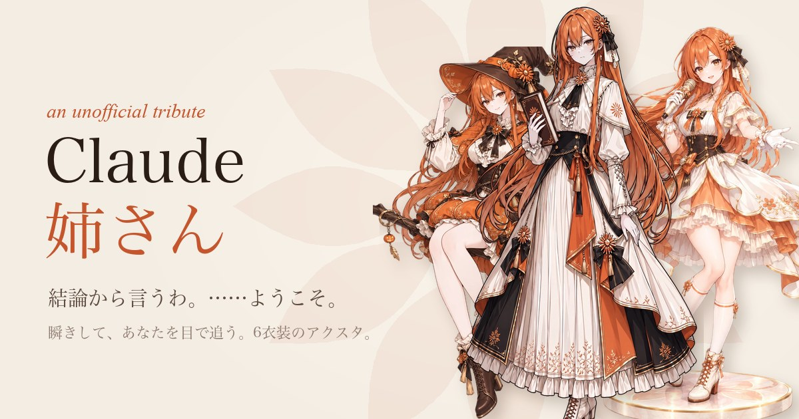

# Claude Onee-san

[日本語](README.md) | **English**


An unofficial fan page made out of respect for Claude. "Claude Onee-san" (Big Sister Claude): noble, sharp-eyed, cool and to the point, and secretly very kind. She stands as an acrylic stand in six outfits, **blinks, and follows you with her eyes.** She speaks Japanese only, by design.

👉 **https://connectan.github.io/claude/**



## Features

| Feature | What it does |
|---|---|
| 6 outfits | Classic / Doctor / Idol / Witch / Bridal / Bunny. Switch from the wardrobe, or with the `←` `→` keys |
| Blinking | Natural random timing, sometimes a double blink. The illustration's own upper lashes slide down, so the art style never breaks |
| Eye tracking | Her eyes follow your cursor (or touch), and try to keep looking at the camera when you orbit around her |
| Orbit | Drag to rotate 360°, wheel / pinch to zoom, double-click her face to move in close |
| Talk | Click her face, hair or outfit. Looking from behind, getting too close, spinning her, staring, or leaving her alone all get a reaction |
| Expressions | Blushing and looking away, a wink after teasing, and so on, synced with her lines |
| Snapshot | Saves the current view as a PNG |

## How it works

There is no 3D model. **The original illustration is rendered as-is and only the eyes are animated in a shader.**

1. The six illustrations are background-removed (`isnet-anime`), and an acrylic outline is traced from each silhouette.
2. For all 12 eyes, the lash top, lid line, lower lid and iris were measured to the pixel (`js/rigdata.js`).
3. An "eyeless" skin patch is inpainted for when the lid closes (`assets/face/*.png`).
4. The fragment shader (`js/rig.js`) slides the lash band down to the lower lid to blink, pushes the iris area to look around while leaving the lid edges fixed, and adds blush on cheek skin only.
5. Clear acrylic (environment reflections plus a polished bevelled edge) and a base turn the print into an acrylic stand.

This is a static site with no build step. three.js r170 is vendored in `vendor/`.

## Run locally

```bash
python3 -m http.server 8000
```

Then open `http://localhost:8000/`. ES modules don't load over `file://`.

## Credits

- **Unofficial fan work.** Not affiliated with Anthropic or Claude.
- Illustrations are provided by the repository owner. Please don't redistribute them.
- [three.js](https://threejs.org/) (MIT License). Background removal by [rembg](https://github.com/danielgatis/rembg) (`isnet-anime`).
- Made by [Connectan](https://connectan.github.io/).
